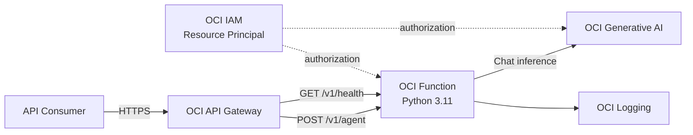

# OCI Serverless AI Agent

[](https://github.com/jorge2026/agente-ia-oci/actions/workflows/ci.yml)
[](LICENSE)
[](https://www.python.org/)
[](https://www.oracle.com/cloud/)

A reference implementation of a **serverless, API-driven generative AI service on Oracle Cloud Infrastructure (OCI)**. The solution exposes an HTTPS API through OCI API Gateway, processes requests in OCI Functions (Python 3.11), and invokes OCI Generative AI using workload identity.

> **Project scope:** portfolio and reference implementation. It is not presented as a production-ready, fully secured multi-tenant AI platform. Review the security and operations roadmap before exposing it to real users or production workloads.

## Architecture



**Request path**

1. The consumer sends an HTTPS request to API Gateway.
2. API Gateway routes the request to the OCI Function.
3. The Function validates the request body and inference parameters.
4. The Function uses an OCI Resource Principal signer to call OCI Generative AI.
5. The Function returns a JSON response and writes operational logs.

See [Architecture Overview](docs/architecture.md) for components, request flow, quality attributes, constraints, and the evolution roadmap.

## Capabilities

- HTTP endpoints for health checks and text generation.
- OCI Functions handler implemented with Python 3.11 and the Functions Development Kit.
- OCI Generative AI inference integration.
- OCI Resource Principal authentication from the Function runtime.
- Input validation for prompt size, temperature, and output token limits.
- Mock mode for local development and CI without live OCI credentials.
- Terraform definitions for Functions, API Gateway, IAM, and Logging resources.
- GitHub Actions workflow for Python lint/smoke checks and Terraform validation.

## API

The Terraform deployment configures the API under the `/v1` prefix.

| Method | Path | Purpose |
|---|---|---|
| GET | `/v1/health` | Basic liveness response |
| POST | `/v1/agent` | Submit a prompt to OCI Generative AI |

Example request:

```bash
curl --fail-with-body -X POST "$API_BASE/v1/agent" \
  -H "Content-Type: application/json" \
  -d '{
    "prompt": "Explain the role of API gateways in cloud architecture.",
    "temperature": 0.3,
    "max_tokens": 256,
    "session_id": "demo-001"
  }'
```

Example response shape:

```json
{
  "response": "Generated text...",
  "session_id": "demo-001",
  "model": "configured-model-id",
  "service": "agente-ia-oci"
}
```

The `session_id` is correlation metadata only; it does not provide conversation memory.

## Repository structure

```text
.
├── .github/workflows/ci.yml       # Python and Terraform checks
├── docs/
│   ├── adr/                       # Architecture decision records
│   ├── architecture.md            # Logical architecture and request flow
│   ├── cost-management.md         # Cost drivers and financial controls
│   ├── observability.md           # Signals, dashboards, and runbook
│   └── security.md                # Current controls and hardening roadmap
├── deploy/oci/                    # Terraform infrastructure
├── function/                      # OCI Function implementation
├── env.example                    # Local configuration template
└── README.md
```

## Run locally

### Prerequisites

- Python 3.11
- Docker and Fn CLI for building/deploying OCI Functions
- OCI CLI and an OCI tenancy for live inference
- Terraform 1.7 or later for the infrastructure configuration

### Install dependencies

```bash
git clone https://github.com/jorge2026/agente-ia-oci.git
cd agente-ia-oci
python -m venv .venv
source .venv/bin/activate
pip install -r function/requirements.txt
cp env.example .env
```

Configure the required values in your local environment. Do not commit `.env`, private keys, or real tenancy identifiers.

### Mock mode

Mock mode is intended for local validation without OCI credentials:

```bash
export MOCK_GENAI=true
export OCI_REGION=us-chicago-1
export COMPARTMENT_ID=ocid1.compartment.oc1..example
export GENAI_MODEL_ID=example-model
```

Use the Fn local development workflow or the test commands in the CI workflow to exercise the handler.

### Deploy with Terraform

Review [deploy/oci/README.md](deploy/oci/README.md) and [deploy/oci/terraform.tfvars.example](deploy/oci/terraform.tfvars.example) first.

```bash
cd deploy/oci
cp terraform.tfvars.example terraform.tfvars
# Edit terraform.tfvars with values for your own OCI tenancy.
terraform init
terraform fmt -check -recursive
terraform validate
terraform plan
```

Only run `terraform apply` after reviewing the plan, IAM policies, networking, costs, and target compartment. The Function image must be built and pushed to OCIR as described in the deployment guide.

## Security and production considerations

Before production use, design and implement:

- API consumer authentication and authorization.
- Per-consumer throttling, quotas, and abuse protection.
- Least-privilege IAM policies and restricted network exposure.
- Sanitized error responses and sensitive-data-safe logging.
- Dependency and container image scanning.
- Data classification, retention, and incident response.
- Budget alerts and model/token consumption monitoring.

Read the [Security Guide](docs/security.md), [Observability Guide](docs/observability.md), and [Cost Management Guide](docs/cost-management.md).

## Architecture decisions

The initial decision to use OCI API Gateway, Functions, Generative AI, Resource Principals, and Terraform is documented in [ADR 0001](docs/adr/0001-serverless-oci-reference-architecture.md).

## Roadmap

- [x] Serverless API and model inference reference flow
- [x] Terraform definitions for core OCI resources
- [x] Mock mode for local/CI validation
- [x] Architecture, security, observability, and cost documentation
- [ ] API authentication and authorization
- [ ] Per-consumer rate limits and quotas
- [ ] Expanded unit and integration test coverage
- [ ] Dependency and image security scanning
- [ ] OCI integration test in a dedicated non-production tenancy
- [ ] Dashboards, alerting, and measured service objectives

## Author

**Jorge Rodriguez**  
Enterprise Systems Engineer | Cloud & Solutions Architecture | Multicloud | AI

- [LinkedIn](https://www.linkedin.com/in/jorge-rodriguez-n/)
- [GitHub](https://github.com/jorge2026)

---

This repository is maintained as a practical learning and architecture portfolio project. Contributions and constructive feedback are welcome.
