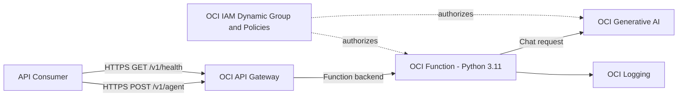

# Architecture Overview

## Purpose

This repository is a reference implementation of a serverless conversational AI API on Oracle Cloud Infrastructure (OCI). It exposes an HTTPS API, invokes an OCI Function, calls OCI Generative AI, and returns a JSON response.

It is a portfolio/reference project. A production deployment requires environment-specific security, network, quota, and operational reviews.

## Current logical architecture

## Request flow

1. A consumer calls the API Gateway endpoint.
2. API Gateway routes `POST /v1/agent` or `GET /v1/health` to the OCI Function.
3. The Function validates the JSON payload.
4. The Function obtains a Resource Principal signer and invokes OCI Generative AI.
5. The Function returns a JSON response and emits operational logs.

## Components and responsibilities

| Component | Responsibility | Current implementation |
|---|---|---|
| OCI API Gateway | HTTPS entry point and route dispatch | Terraform deployment with `/agent` and `/health` |
| OCI Functions | Stateless request handling | Python 3.11 FDK handler |
| OCI Generative AI | Text generation | Generative AI Inference client |
| OCI IAM | Workload identity and authorization | Dynamic group and policies in Terraform |
| OCI Logging | Function invocation logs | Log group and service log resources |
| Terraform | Infrastructure provisioning | Resources in `deploy/oci` |
| GitHub Actions | Repository validation | Python lint/smoke checks and Terraform validation |

## Quality attributes

- **Scalability:** Function-based execution avoids managing application servers.
- **Security:** Resource Principal authentication avoids embedding OCI API keys in the Function runtime.
- **Reliability:** Separate health and inference routes provide a basic operational probe and application endpoint.
- **Cost awareness:** Token and prompt limits exist; quotas, concurrency, and budgets must also be configured in the tenancy.
- **Maintainability:** Infrastructure is described as code and the API handler is kept in a small Python module.

## Important design constraints

- The current API is synchronous. The caller waits for model inference to complete.
- The current `session_id` is correlation metadata; it does not implement conversation memory.
- The current endpoint does not implement end-user authentication or tenant isolation. Do not expose it as a public production API without an authentication and authorization design.
- The current Terraform example uses a public API Gateway endpoint. Restrict access according to the target environment.
- OCI Generative AI model availability, request limits, and pricing depend on region, model, and tenancy configuration.

## Evolution roadmap

1. Add API authentication and authorization (for example, JWT validation at the gateway or an authenticated backend).
2. Add request correlation IDs, structured metrics, and alerts.
3. Add rate limiting, abuse protection, and explicit quotas per consumer.
4. Add automated security and dependency scanning.
5. Evaluate private networking, WAF, secret management, and multi-environment Terraform state.
6. Add integration tests against a non-production OCI tenancy.
